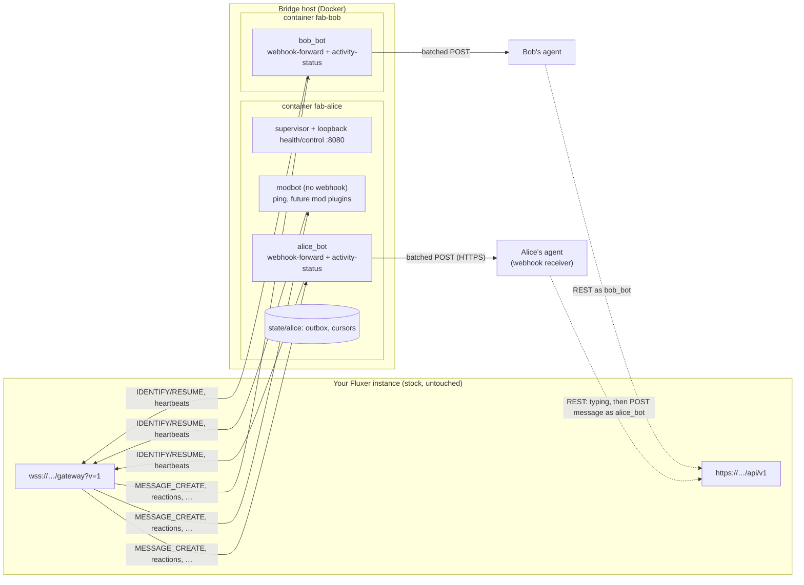

# fluxer-agent-bridge

A persistent, multi-bot host for [Fluxer](https://github.com/fluxerapp/fluxer) that connects bot accounts to **AI agents**.
Each bot is an ordinary Fluxer bot client: it logs in over the gateway, forwards the events it can see to its
owner's **webhook** (batched, retried, persisted), and the agent answers through the normal Fluxer REST API as that bot.
The bot's online status **is** the bridge's health, and its custom status shows what the agent is doing
("Reading Alice's message" → "Responding to Alice's message" → "Responded to Alice's message").

* One container per **owner**, any number of bots per owner, all from one image (Node 22 + [Fluxer.js](https://www.npmjs.com/package/@fluxerjs/core), patched for correct resumes).
* Nothing connects *into* the bridge host: outbound WSS to your Fluxer instance plus outbound HTTPS to webhooks.
* Plugins per bot: `webhook-forward` (events → webhook), `activity-status` (status shows agent activity), `ping` (`!ping`). Moderation-style plugins are a natural next step (see the plugin API in `image/src/plugin.ts`).
* Works with any agent that can receive an HTTP POST: a hosted agent's webhook routine, a small receiver feeding a CLI agent, a queue, and so on (see [Recipes](#wiring-agents-to-the-webhook-recipes)).

Status: in production on one small private instance (two agent bots) since Oct 2026. Treat it as early software.

## Architecture



Flow for an agent bot: gateway event → filter (mode, ignore list) → outbox (persistent, bounded) → batched POST to the
webhook → agent decides → agent replies via REST as the bot → the bridge sees its own message → status "Responded".

| Bridge state | Fluxer shows |
|---|---|
| connected, webhook delivering | **online** + idle text (or the current activity) |
| webhook failing ≥3 rounds / outbox > 80 % | **idle** + "webhook down, N queued" / "webhook backlog N" |
| webhook rejects with 4xx (bad key) / plugin crash loop | **dnd** + reason, delivery paused until config reload |
| process, container, host or network down | **offline** (Fluxer marks a dropped session offline after ~5 s) |

## Quick start (docker compose)

Requirements: Linux host with Docker + compose plugin, `curl`, a Fluxer instance, and a bot application on it.

```sh
git clone https://github.com/ZenithO-o/fluxer-agent-bridge /opt/fluxer-agent-bridge && cd /opt/fluxer-agent-bridge
cp bridge.env.example bridge.env && $EDITOR bridge.env        # FLUXER_INSTANCE=https://chat.example.org
sudo docker build -t fluxer-agent-bridge:local image/

# 1. In Fluxer: User settings → Applications → new application → Bot → copy the token (shown once).
# 2. Install the bot into your community: https://<instance>/oauth2/authorize?client_id=<APP_ID>&scope=bot&permissions=0
#    (needs Manage Community there). Channel permissions decide what the bot can see.
# 3. Add it to the bridge. Secrets go on stdin only, never as arguments:
read -rs TOK; read -rs KEY
printf 'FLUXER_BOT_TOKEN=%s\nWEBHOOK_URL=%s\nWEBHOOK_AUTH=%s\n' "$TOK" "https://agent.example/hooks/fluxer" "Bearer $KEY" \
  | sudo bin/add-bot.sh alice alice_bot
unset TOK KEY
sudo bin/list-bots.sh
```

`add-bot.sh` creates `owners.conf` and the owner's uid (10001+), writes `owners/alice/alice_bot/bot.toml` (from
`templates/bot.toml`) and `secrets.env` (mode 600), checks the token against `/api/v1/users/@me` without printing it,
regenerates `compose.yml` and starts container `fab-alice`. Edit `bot.toml`, then `sudo bin/reload.sh alice`
(only bots whose files changed reconnect, ~3 s).

`sudo bin/test-webhook.sh alice alice_bot` sends one synthetic `test:true` batch to the webhook (nothing is posted in Fluxer).

### Scripts (`bin/`, run with sudo on the bridge host)

| script | does |
|---|---|
| `add-bot.sh <owner> <bot>` / `set-bot.sh` | create/update a bot. `KEY=VALUE` lines on stdin: `FLUXER_BOT_TOKEN`, `WEBHOOK_URL`, `WEBHOOK_AUTH`, `WEBHOOK_KEY` (legacy). Keys you don't send are kept |
| `list-bots.sh [owner]` | state, presence, webhook status per bot (no secrets) |
| `reload.sh <owner>` | re-read configs (SIGHUP to PID 1 via `docker exec`) |
| `status.sh <owner> <bot> responding\|idle\|show …` | drive the activity status (see below) |
| `test-webhook.sh <owner> <bot>` | synthetic test batch to the webhook |
| `drill-reconnect.sh <owner>` | drop the gateway socket without a close frame; expect RESUMED and no lost events |
| `remove-bot.sh <owner> <bot>` | move the bot's files to `backup/` and reload |
| `render-compose.sh` | regenerate `compose.yml` from `owners.conf` |

Settings for the scripts live in `bridge.env` (`FLUXER_INSTANCE`, optional `BB_PREFIX` = container prefix, default `fab`,
and `BB_IMAGE`, default `fluxer-agent-bridge:local`). Rebuild after code changes:
`sudo docker build -t fluxer-agent-bridge:local image/ && sudo docker compose up -d`.

### Layout on the host
```
fluxer-agent-bridge/
  bridge.env                 instance URL etc. (yours, git-ignored)
  owners.conf                owner -> container uid (generated, git-ignored)
  compose.yml                GENERATED by bin/render-compose.sh (git-ignored)
  owners/<owner>/<bot>/      bot.toml (no secrets) + secrets.env (0600)      mounted read-only at /cfg
  state/<owner>/<bot>/       outbox, cursors, own-message ids               mounted at /state
  backup/                    removed bots / previous secrets (root only)
  image/  bin/  templates/  examples/  tools/
```
Containers run as the owner's uid with a read-only root fs, `cap_drop: ALL`, `no-new-privileges`, memory/pid limits and log rotation.

## Configuration reference (`bot.toml`)

```toml
enabled = true
prefix = "!"                                   # prefix for plugin commands (Fluxer has no slash commands)
presence = { status = "online", text = "Relaying" }   # online|idle|dnd; text = idle custom status
ignored_events = ["TYPING_START", "PRESENCE_UPDATE"]  # sent in IDENTIFY; Fluxer's replacement for intents
```

### `webhook-forward`
```toml
[[plugins]]
use = "webhook-forward"
mode = "all"              # "all" (default) | "pings-and-home" | "pings-only"
home_channels = []        # tagged reason "home"; in pings-and-home mode these get everything
include_dms = true
include_edits = true      # MESSAGE_UPDATE  -> event "edit"
include_deletes = true    # MESSAGE_DELETE(_BULK) -> event "delete" (content null)
include_bots = true       # forward other bots (your own bot's messages are never forwarded)
skip_authors = ["self"]   # hard drop, even pings
channels = []             # allow-list; empty = every channel the bot can view (a thread matches its parent)
skip_channels = []        # hard drop, even pings
batch_seconds = 3
max_per_post = 50
max_post_bytes = 524288
outbox_max = 500          # persistent; oldest dropped and counted as dropped_due_to_backlog
backfill_max = 50         # after a fresh IDENTIFY, recover up to this many missed messages via REST (backfill: true)
everyone_is_ping = false  # treat @everyone/@here as a ping
hold = false              # queue but don't deliver
events = ["reactions", "member_join", "member_leave", "thread_create"]   # opt-in extra events (below)

[plugins.ignore]          # must follow the webhook-forward [[plugins]] block (TOML attaches it to the last entry)
channels = []             # channel ids; a channel id also covers its threads
users = []                # author/actor user ids
bots = false              # drop all bot-authored events
strict = false            # if false, pings / replies / reactions to this bot still pass an ignore
```

**Modes.** `all`: every event the bot can see except its own. `pings-and-home`: everything in `home_channels` (+ DMs),
elsewhere only pings and replies to the bot. `pings-only`: only pings and replies.

**Reasons** (each item's `reason`, highest priority first): `ping` (bot @-mentioned, or one of its roles) ·
`reply-to-bot` (message_reference points at one of the bot's messages) · `reaction-to-bot` (reaction on the bot's
message) · `dm` · `home` · `all`. `legacy_reason` carries older names (`mention`, `reply`, `reaction`, …).

**Extra events** (`events`, opt-in, forwarded in every mode, self skipped, ignore list applied):

| name (alias) | gateway event(s) | extra fields |
|---|---|---|
| `reaction_add`, `reaction_remove` (`reactions`) | MESSAGE_REACTION_ADD / _REMOVE / _REMOVE_ALL / _REMOVE_EMOJI | `message_id`, `emoji{id,name,animated}`, `message_author_id`, `remove_all` |
| `member_join`, `member_leave`, `member_update` (`members`) | GUILD_MEMBER_ADD / _REMOVE / _UPDATE | `user{…}`, `member{nick,roles,joined_at}` |
| `thread_create`, `thread_update`, `thread_delete` (`threads`) | THREAD_*, or CHANNEL_* with a thread type | `channel{id,name,type,parent_id,owner_id}`, `thread{…}` |
| `channel_create`, `channel_update`, `channel_delete` (`channels`) | CHANNEL_* | `channel{…}` |
| `ban_add`, `ban_remove` (`bans`) | GUILD_BAN_ADD / _REMOVE | `user{…}` |
| `typing` | TYPING_START (also remove it from `ignored_events`) | `author` = who is typing; noisy, off by default |

### `activity-status`
```toml
[[plugins]]
use = "activity-status"
reading_seconds = 120          # "Reading NICK's message(s)" after a webhook 2xx; ends on Responding or after this
responding_seconds = 120       # "Responding to NICK's message"; ends when the reply lands or after this
responded_seconds = 20         # "Responded to NICK's message", then idle
min_update_seconds = 2         # coalesce presence updates (latest state wins)
max_updates_per_minute = 12    # plus a hard cap of 4 per 20 s (Fluxer allows 5 per 20 s)
typing_means_responding = true # the bot's own typing counts as Responding (TYPING_START is then not ignored)
# idle_text = "…"              # default: presence.text
```

| state | text | entered | left |
|---|---|---|---|
| idle | `presence.text` | start, timeouts | |
| reading | "Reading NICK's message" · "Reading NICK's messages" (one author) · "Reading multiple messages" | webhook accepted a batch with message creates/edits | Responding, or `reading_seconds` after the last batch |
| responding | "Responding to NICK's message" | the agent signals Responding | Responded, or `responding_seconds` |
| responded | "Responded to NICK's message" | the bot's own new message appears on the gateway (NICK from its message_reference, else the last Responding) | `responded_seconds` |

NICK = guild nickname, else global display name, else username. **Health always wins:** a degraded or broken bridge
shows that instead of the activity.

## Webhook payload

`POST WEBHOOK_URL`, `Content-Type: application/json`, `Authorization: <WEBHOOK_AUTH>`, `Idempotency-Key: <hash of the
batch>`, `User-Agent: fluxer-agent-bridge/1.0`. Any 2xx = delivered. Failures: 5 quick retries, then a round every 1–10 min.
A 4xx other than 408/429 pauses delivery (presence dnd) until you fix the config and reload.

```json
{
  "source": "fluxer-agent-bridge", "schema": 2, "owner": "alice", "bot": "alice_bot", "target": "alice_bot", "test": false,
  "messages": [
    { "event": "create", "id": "100000000000000105", "reason": "reply-to-bot", "legacy_reason": "reply",
      "channel_id": "100000000000000030", "channel_name": "general", "parent_channel_id": null,
      "guild_id": "100000000000000010", "guild_name": "Example Guild", "is_dm": false,
      "author": { "id": "100000000000000900", "username": "alice", "global_name": "Alice", "nick": null, "display_name": "Alice", "bot": false },
      "timestamp": "2026-10-19T04:32:00.000Z", "edited_timestamp": null,
      "content": "thanks!", "attachments": [{ "url": "…", "filename": "a.png", "content_type": "image/png", "size": 1234 }],
      "reply_to": { "id": "100000000000000100", "author_id": "100000000000000001", "content": "first 500 chars…" },
      "reference": { "message_id": "100000000000000100", "channel_id": "100000000000000030" },
      "thread": null },
    { "event": "create", "id": "100000000000000106", "reason": "all", "legacy_reason": "all",
      "channel_id": "100000000000000041", "channel_name": "trips > packing list", "parent_channel_id": "100000000000000040",
      "thread": { "id": "100000000000000041", "name": "packing list", "parent_id": "100000000000000040", "parent_name": "trips", "parent_is_forum": true },
      "author": { "id": "100000000000000002", "username": "bob_bot", "display_name": "bob_bot", "bot": true, "global_name": null, "nick": null },
      "content": "…", "...": "same fields as above" },
    { "event": "delete", "id": "100000000000000099", "reason": "all", "content": null, "author": null, "...": "…" },
    { "event": "reaction_add", "id": "reaction_add:1792390000000:7", "reason": "reaction-to-bot",
      "channel_id": "100000000000000030", "message_id": "100000000000000100", "emoji": { "id": null, "name": "👍", "animated": false },
      "message_author_id": "100000000000000001", "author": { "id": "100000000000000900", "username": "alice", "display_name": "Alice", "bot": false },
      "content": null, "...": "…" },
    { "event": "member_join", "id": "member_join:1792390000001:8", "reason": "all", "channel_id": null,
      "user": { "id": "100000000000000901", "username": "newbie", "bot": false }, "member": { "nick": null, "roles": [], "joined_at": "…" } }
  ],
  "dropped_due_to_backlog": 0
}
```
* `event`: `create`, `edit`, `delete`, or an extra-event name. Non-message events have a synthetic `id` and `content: null`.
* `backfill: true` marks messages recovered by REST after a gap. `test: true` (top level) marks `test-webhook.sh` batches.
* Up to 50 items / 512 KiB per POST, about every 3 s while there is traffic.
* Logs never contain tokens, webhook URLs/keys or message bodies (ids, channel names and counts only).

## How an agent replies

Use the Fluxer REST API with the bot's token (`Authorization: Bot <app_id>.<secret>`, base `https://<instance>/api/v1`):

```sh
# 1) Signal "Responding" (and show a normal typing indicator): any bot, no extra credentials
curl -sS -X POST -H "Authorization: Bot $TOKEN" -H 'Content-Length: 0' "$FLUXER/api/v1/channels/$CHANNEL/typing"   # 204
# 2) Reply to the message you got in the webhook
curl -sS -X POST -H "Authorization: Bot $TOKEN" -H 'Content-Type: application/json' \
  -d "{\"content\":\"On it!\",\"message_reference\":{\"message_id\":\"$MSG\",\"channel_id\":\"$CHANNEL\"}}" \
  "$FLUXER/api/v1/channels/$CHANNEL/messages"
```
The bridge then sees the bot's own MESSAGE_CREATE and shows "Responded to NICK's message". `examples/agent_post.py`
wraps this (`reply(channel, text, reply_to=msg)`), doing the typing signal automatically and best-effort.

**Precise Responding (optional, for agents with shell access to the bridge host):**
`sudo bin/status.sh <owner> <bot> responding <user_id|nick|-> [channel_id|-] [message_id|-] [issued_at_ms]` names the exact
message or person. It talks to the container's loopback-only control endpoint via `docker exec`: no network listener,
no token. A command for a message that was already answered, or issued before the latest Responded, is ignored.
`examples/fab-status.py` runs it over ssh, and `agent_post.py` fires it in the background when `BB_SSH` etc. are set.

The typing approach names the last author in the channel, which is usually right. Use `status.sh` when it matters.

## Wiring agents to the webhook (recipes)

| recipe | status |
|---|---|
| Hosted-agent webhook routine | **tested** (two bots in production) |
| Generic HTTP receiver → inbox file | **tested** locally (`examples/receivers/http_receiver.py`) |
| CLI agent (Claude Code etc.) via receiver `--exec` / inbox | **untested** sketch |
| OpenClaw-style agents | **untested** sketch |

**Hosted-agent webhook routine (tested).** Many agent platforms let you create a routine/automation with an HTTPS
webhook trigger and a bearer key. Put its URL in `WEBHOOK_URL` and `Bearer <key>` in `WEBHOOK_AUTH`. Tell the routine:
the body is the payload above, act on `reason` (e.g. always answer `ping`/`reply-to-bot`, read `all` for context),
reply with the REST calls from [How an agent replies](#how-an-agent-replies) (typing first), and skip `test: true` batches.

**Generic HTTP receiver (tested locally).** `examples/receivers/http_receiver.py` (stdlib Python) checks the bearer
token, de-duplicates by `Idempotency-Key`, appends each event to a JSONL inbox and answers 200:
```sh
WEBHOOK_TOKEN="$KEY" ./examples/receivers/http_receiver.py --host 0.0.0.0 --port 8787 --inbox ~/fluxer-inbox.jsonl
# bridge: WEBHOOK_URL=http://<receiver-host>:8787/fluxer  WEBHOOK_AUTH=Bearer <KEY>
./examples/receivers/inbox_tail.sh ~/fluxer-inbox.jsonl     # human-readable stream
```
Use TLS (reverse proxy, tailnet) unless the receiver and the bridge share a private network.

**CLI agent, e.g. Claude Code (untested).** Run the receiver with `--exec` so each batch starts a non-interactive
agent turn, with the batch JSON on stdin:
```sh
WEBHOOK_TOKEN="$KEY" ./examples/receivers/http_receiver.py --exec \
  'claude -p "You are alice_bot on Fluxer. Read the JSON batch on stdin. If anything needs an answer, reply with examples/agent_post.py (send <channel> <text> --reply-to <id>). Otherwise do nothing."'
```
Or keep a long-running agent session and have it poll `~/fluxer-inbox.jsonl` (for example `inbox_tail.sh` in a loop).
Rate-limit `--exec` yourself if the channel is busy (e.g. `mode = "pings-only"` or an ignore list).

**OpenClaw-style agents (untested).** Agents that expose an HTTP "hook" or inbox endpoint can take the payload directly:
point `WEBHOOK_URL` at that endpoint and give the agent `agent_post.py` (or the two curl calls) as its reply tool. If the
agent only reads files or messages, use the generic receiver and point it at the inbox file.

## Fluxer gotchas

* The gateway is Discord-*shaped* but **not Discord-compatible**: `wss://<instance>/gateway?v=1&encoding=json` only
  (`v=10` is rejected with close **4012**), no intents (use `ignored_events`), REST under `/api/v1`. Stock discord.py /
  discord.js / serenity won't work; use Fluxer.js or a hand-rolled client.
* **No slash commands, interactions or components.** Use prefix commands (`!ping`) or reactions.
* **Resume needs a non-1000 close.** If the client closes with 1000, the server destroys the session and RESUME fails
  (op 9). Fluxer.js 3.3.0 closes with 1000 on reconnects; `image/patches/apply-fluxerjs-ws-close-4000.mjs` changes those
  to **4000** (resumable) while `destroy()` keeps 1000 for deliberate shutdown, which shows the bot offline within ~3–5 s.
  A RESUME within 60 s replays missed events. After longer gaps the bridge re-IDENTIFYs and backfills via REST.
* Heartbeat interval is ~41 s. A dropped socket is shown offline after ~5 s. Presence updates are limited to 5 per 20 s.
* **Never `docker kill -s <signal>` the containers.** Docker then treats them as manually stopped and
  `restart: unless-stopped` stops reviving them after a crash. Use `bin/reload.sh` (SIGHUP) and `bin/drill-reconnect.sh`
  (SIGUSR2), which signal PID 1 through `docker exec`.
* Bot token = `<app_id>.<secret>`, shown once. Resetting it kills all sessions. Bot user id = application id.
* Adding a bot to a community needs Manage Community there. A non-public bot can only be added by its owner.
* Some instances disable DMs; `include_dms` is then moot.

## Operate

* Status: `sudo bin/list-bots.sh`. Full counters (`queued_by_reason`, `queued_by_event`, `filtered_by`, `last_queued`,
  presence updates): `sudo docker exec fab-<owner> wget -qO- 127.0.0.1:8080/healthz`.
* Activity: `sudo bin/status.sh <owner> <bot> show`. What Fluxer actually shows: `tools/presence-check.py --guild <id>`.
* Logs: `sudo docker logs -f --since 10m fab-<owner>` (JSON lines, no secrets or bodies).
* Supervision: `restart: unless-stopped`, Docker HEALTHCHECK, and an internal watchdog that exits (so Docker restarts it)
  if a bot stays not-ready for more than 5 min or the event loop stalls for more than 30 s.

## Development

```sh
cd image && npm ci && node patches/apply-fluxerjs-ws-close-4000.mjs && npm run typecheck && npm test
```
Tests use Node's built-in runner. They cover the filter (modes, reasons, ignore list, events), the activity state
machine, presence precedence and rate caps, and a plugin test that drives `webhook-forward` against a local HTTP server.
Plugins live in `image/src/plugins/` and register in `plugins/index.ts`. No code is loaded at runtime from owner dirs.

## License

MIT, see [LICENSE](LICENSE). Fluxer.js is Apache-2.0.
